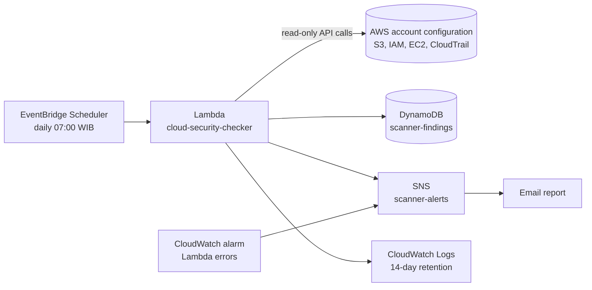
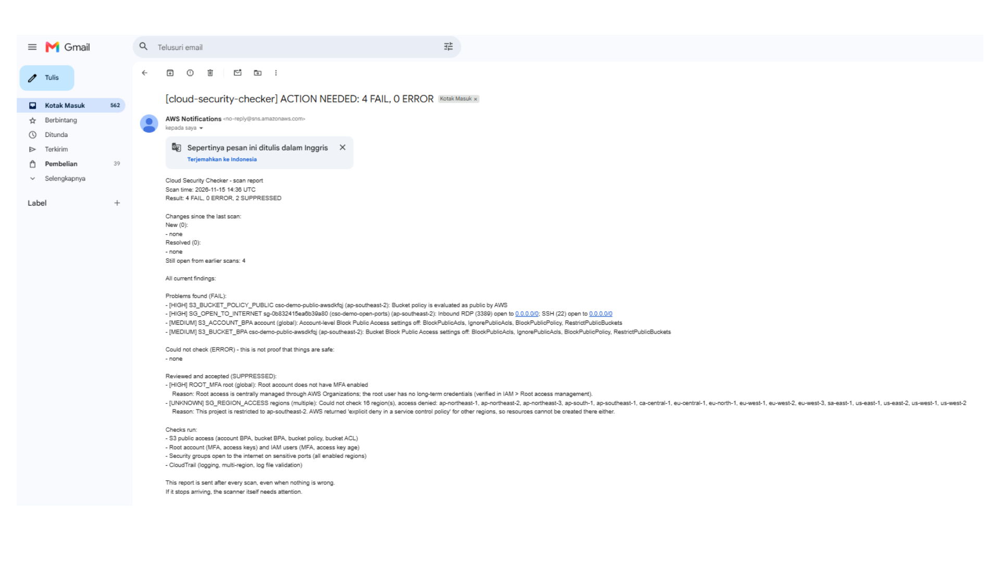
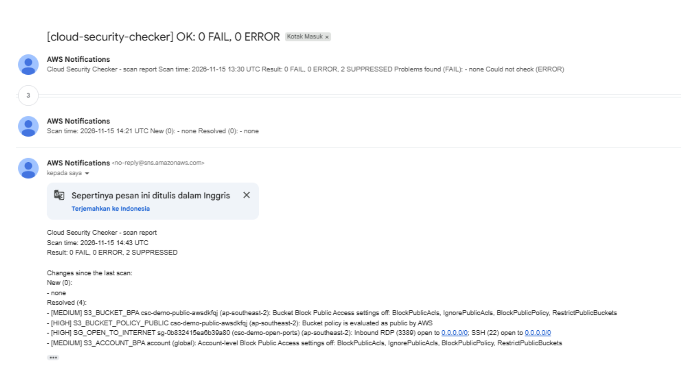
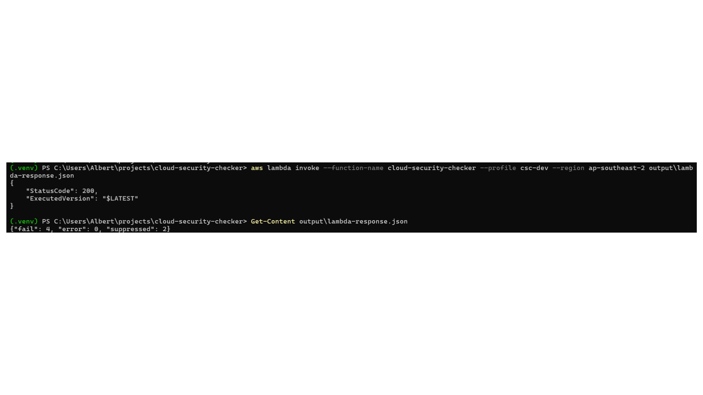
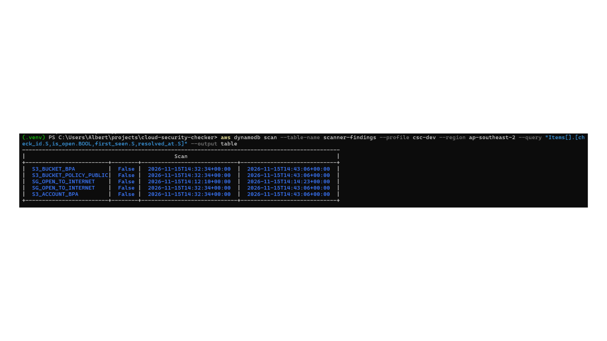

# Cloud Security Checker

A small serverless scanner that checks my own AWS account every morning for common
security misconfigurations, remembers what it found, and emails me a report.

Built as a hands-on learning project in cloud security. It is not a replacement for
AWS Config or Security Hub; see the [comparison](docs/aws-config-comparison.md).

## What it does

- Runs every day at 07:00 (Asia/Jakarta) on AWS Lambda
- Checks S3 public access, the root account, IAM users, security groups, and CloudTrail
- Stores each finding in DynamoDB, so the report shows what is **new** and what was **resolved**
- Emails a report after every scan, even when nothing is wrong, so a missing email means
  the scanner itself is broken
- Raises a CloudWatch alarm if the Lambda function fails
- All infrastructure is defined in Terraform

## Architecture



## Checks

| Check ID | What it looks for | Severity |
|---|---|---|
| `S3_ACCOUNT_BPA` | Account-level S3 Block Public Access is off or missing | MEDIUM |
| `S3_BUCKET_BPA` | Bucket-level S3 Block Public Access is off or missing | MEDIUM |
| `S3_BUCKET_POLICY_PUBLIC` | A bucket policy that AWS evaluates as public | HIGH |
| `S3_BUCKET_ACL_PUBLIC` | A bucket ACL granting access to AllUsers or AuthenticatedUsers | HIGH |
| `ROOT_ACCESS_KEYS` | The root account has access keys | HIGH |
| `ROOT_MFA` | The root account does not have MFA | HIGH |
| `IAM_USER_NO_MFA` | An IAM user can sign in to the console without MFA | MEDIUM |
| `IAM_ACCESS_KEY_OLD` | An active access key older than 90 days | MEDIUM |
| `SG_OPEN_TO_INTERNET` | SSH, RDP, database, Redis, MongoDB, or all traffic open to `0.0.0.0/0` or `::/0` | HIGH |
| `CLOUDTRAIL_NOT_ENABLED` | No trail is logging | MEDIUM |
| `CLOUDTRAIL_NOT_MULTI_REGION` | Logging trails cover only one region | LOW |
| `CLOUDTRAIL_LOG_VALIDATION_OFF` | Log file validation is disabled | LOW |

Each finding has a status:

- **FAIL**: a problem was found
- **ERROR**: the check could not run (for example AccessDenied). This is never treated as safe.
- **SUPPRESSED**: reviewed and accepted, with a written reason. Still shown in every report.

## Demo

Five deliberate misconfigurations were created on the account (an empty public bucket,
account Block Public Access turned off, and a security group with SSH and RDP open, not
attached to any instance), then fixed.

| Detected | Resolved |
|---|---|
|  |  |



History in DynamoDB, with when each finding was first seen and resolved:



## Security design

The scanner is itself a security tool, so it must not become a new risk.

- **Least privilege.** The Lambda role uses a custom policy with only the read actions the
  code calls. It cannot change or delete any resource it checks, and it cannot read data
  such as S3 objects. The only write access is to its own log group, SNS topic, and
  DynamoDB table, each limited by ARN. There is no `DeleteItem`, so it cannot erase its
  own history.
- **`Resource: "*"` where required.** Account-level actions such as `s3:ListAllMyBuckets`
  and `ec2:DescribeSecurityGroups` do not support resource-level permissions.
- **Scheduler role.** Can only invoke this one function, and its trust policy only allows
  EventBridge Scheduler from this account (`aws:SourceAccount`), to prevent the confused
  deputy problem.
- **No long-term credentials.** Local work uses temporary credentials from `aws login`.
  There are no IAM users or access keys.
- **No secrets in the repository.** The account ID is never written in code (Terraform
  builds ARNs from data sources), and the alert email lives in an ignored `terraform.tfvars`.

## Engineering decisions

**Why Lambda and EventBridge Scheduler?** One short run a day does not justify a server.
Scheduler supports a time zone and a retry policy (2 retries within 1 hour).

**Why send a report even with 0 findings?** If emails were only sent on problems, silence
would mean either "safe" or "broken". A daily report makes a missing email a signal.

**Why DynamoDB?** Lambda has no memory between runs. Storing open findings lets the report
highlight changes instead of repeating the same list every day.

**Why suppressions instead of deleting checks?** `ROOT_MFA` is important on most accounts.
On this one, root access is centrally managed and the root user has no credentials, so the
finding is a false positive. It is suppressed with a written reason and stays visible.

**Why import into Terraform instead of recreating?** The resources were first built by hand
to learn each service. Importing them avoided downtime and a new email confirmation, and
`terraform plan` then showed "No changes", proving the code matches what is running.

## What I learned (problems found while testing)

1. **False positive on root MFA.** The account summary reported root without MFA. I checked
   IAM > Root access management and found centralized root access, then suppressed the
   finding with a reason.
2. **Region access denied.** 16 of 17 regions returned AccessDenied. The AWS CLI error showed
   an explicit deny in an organization service control policy, so the finding was suppressed
   with that evidence.
3. **Suppressions only handled FAIL**, so a verified ERROR stayed visible. Fixed, and the
   original status is now kept in `original_status`.
4. **Misleading subject.** When the DynamoDB update failed, the email still said "OK".
   It now says "ACTION NEEDED ..., HISTORY ERROR".
5. **Overwritten history keys.** The demo reported 5 problems but only 4 new ones. Two rules
   on the same security group shared one key (`check_id#resource#region`). The check now
   produces one finding per security group.

## Comparison with AWS Config

On a clean account, AWS Config and the scanner agreed on every check. AWS Config detected an
open SSH rule within about 1 to 3 minutes, while this scanner runs once a day. Security Hub
was blocked by the organization on this account. Details:
[docs/aws-config-comparison.md](docs/aws-config-comparison.md).

## Scope and limitations

- Checks one AWS account (my own) in one region, plus a region list for security groups
- A small set of checks; a clean report is not proof that the account is secure
- Runs once a day, so problems can exist for up to a day before they are reported
- Does not fix anything automatically; it only reports
- `IAM_USER_NO_MFA` was not demonstrated, because it would require creating a real console
  password, and IAM users for people are discouraged on this account type
- Only run it against accounts you own or are authorized to check

## Repository structure

```
cloud-security-checker/
├── src/                Python code for the checks and the Lambda handler
├── terraform/          All infrastructure (Lambda, IAM, DynamoDB, SNS, Scheduler, alarm)
├── docs/               Comparison with AWS Config and demo screenshots
├── NOTES.md            Session-by-session build log
└── requirements.txt    Local Python dependencies
```

## Running it

**Locally (read-only scan):**

```powershell
python -m venv .venv
.\.venv\Scripts\Activate.ps1
pip install -r requirements.txt
aws login --profile csc-dev --region ap-southeast-2
python src/scan.py
```

**Deploying with Terraform:**

1. Create a private, versioned S3 bucket for the state, and set its name in
   `terraform/versions.tf`.
2. Copy `terraform/terraform.tfvars.example` to `terraform/terraform.tfvars` and set
   `alert_email`.
3. Export temporary credentials and deploy:

   ```powershell
   aws configure export-credentials --profile csc-dev --format powershell | Invoke-Expression
   cd terraform
   terraform init
   terraform plan
   terraform apply
   ```
4. Confirm the SNS subscription from the email AWS sends.

Not managed by Terraform: the CloudTrail trail and account-level S3 Block Public Access
(these are what the scanner checks, not part of it), and the state bucket.

## Built with

Python (boto3), AWS Lambda, EventBridge Scheduler, DynamoDB, SNS, CloudWatch, IAM, Terraform.